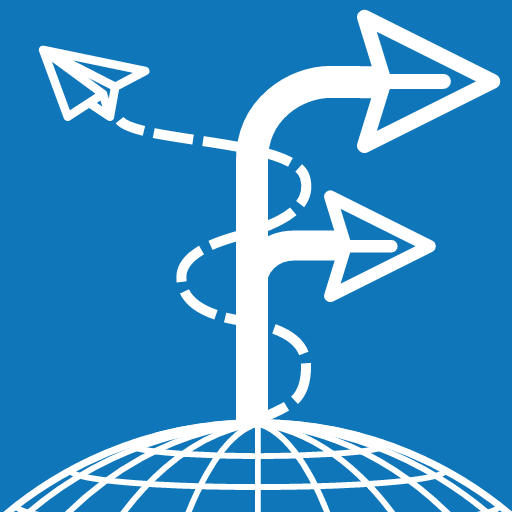

<p align="center">
  
</p>

# ctrlyoke

ctrlyoke is a VS Code extension and workflow engine for CLI coding agents — Claude Code, Codex, Copilot CLI, OpenCode, Qwen Code, and Antigravity. Each CLI coding agent you run through ctrlyoke is a _harness_. ctrlyoke doesn't bundle or replace any of these CLIs: it calls the ones you've installed and signed in to. Prompt, steer, automate, and revisit sessions with any supported harness: send a single prompt, or define a structured YAML/JSON/Markdown workflow that keeps working through its steps without you re-prompting each one.


---

## What it does

- **Sequential prompt execution** — define prompts in a YAML or JSON workflow file; ctrlyoke sends them one at a time, waits for each to finish, and advances automatically
- **Script-based validation** — attach an end condition script to any prompt; by default the step passes when the script exits 0, and you can instead compare its stdout/stderr with an explicit operator. Otherwise the AI retries with a configurable retry prompt
- **Harness-agnostic** — switch between six AI harnesses with one setting; the workflow format, permissions, agent/skill injection, and the output dashboard stay the same
- **Dynamic workflows** — include `"ctrlyoke"` in `mcpServers` to let the AI append steps to the running workflow with ctrlyoke's [MCP tools](https://ctrlyoke.dev/docs/reference/mcp-tools)
- **User-defined hooks** — attach shell commands to harness lifecycle events (`sessionStart`, `userPromptSubmit`, `preToolUse`, `postToolUse`, `permissionRequest`, `notification`, `stop`, `error`) per prompt, per workflow, or globally in settings
- **Universal agents and skills** — define agent instruction files once; ctrlyoke discovers them from standard locations (`.github/agents/`, `.claude/agents/`, `.ctrlyoke/agents/`) and injects content into prompts regardless of harness
- **Dashboard with embedded terminal** — a secondary side bar UI with a CodeMirror prompt editor, live xterm.js terminal running the AI CLI directly, streaming output with tool-call visualization, file diff views, undo/redo for workspace changes, and per-run output history


---

## Requirements

- VS Code 1.106.0 or higher
- Node.js 22.12.0 or higher
- At least one supported harness installed and authenticated

---

## Supported Harnesses

| Harness ID        | Description                                                                           |
| ----------------- | ------------------------------------------------------------------------------------- |
| `copilot-cli`     | GitHub Copilot CLI — log file monitoring, session resumption                          |
| `claude-cli`      | Anthropic Claude Code CLI — JSON streaming, hook-based completion                     |
| `codex-cli`       | OpenAI Codex CLI — JSONL events, notify hook                                          |
| `opencode-cli`    | OpenCode CLI — JSONL events, config-file permissions                                  |
| `qwen-cli`        | Qwen Code CLI — JSONL events, log-based session discovery                             |
| `antigravity-cli` | Google Antigravity CLI — plain-text output, hook-based completion, MCP config support |

By default ctrlyoke uses the first installed harness in alphabetical order. To pick one, set it in `.ctrlyoke/settings.json`:

```json
{ "defaults": { "harness": "claude-cli" } }
```

CLI harnesses run in **interactive** mode (VS Code terminal with live output) or **headless** mode (background process). Configure `defaults.executionMode` in `.ctrlyoke/settings.json`.

---

## Getting Started

### 1. Open the panel

```
Command Palette → ctrlyoke: Open ctrlyoke Panel
```

The panel opens in the VS Code secondary side bar.

### 2. Create a workflow

**From a template:**

```
Panel → New Workflow from Template
```

**Manually** — create a `.ctrlyoke.yaml` file in your workspace.

**Simple single prompt** — create a `.prompt.md` file:

```markdown
Analyze @src/auth/login.ts for security issues.
Focus on input validation and authentication logic.
```

### 3. Run

- **Panel** — load a workflow file and click Run
- **Run with ctrlyoke submenu** — right-click any prompt file in the Explorer or editor, or
  use the editor title toolbar, then choose **Run with ctrlyoke**
- **Run with ctrlyoke submenu** — choose **Queue Steps with ctrlyoke** or **Queue Steps Next with
  ctrlyoke** to append to an active queue; these actions appear only once the active queue
  already contains steps

---

## Workflow File Formats

All three formats validate against the same JSON Schema with full IntelliSense in VS Code.

| Format   | Extension                          | Best for                            |
| -------- | ---------------------------------- | ----------------------------------- |
| YAML     | `.ctrlyoke.yaml` / `.ctrlyoke.yml` | Multi-step workflows, human editing |
| JSON     | `.ctrlyoke.json`                   | Programmatic generation, CI/CD      |
| Markdown | `.prompt.md`                       | Single prompts                      |

### Multi-step YAML workflow

```yaml
# Workflow-level defaults — overridden per prompt (three-tier: prompt > workflow > settings)
harness: claude-cli
model: claude-sonnet-4.5
endCondition:
  script: npm test
  compareSource: exitCode
  expected: 0

steps:
  - name: analyze
    prompt: |
      Analyze @src/ for security vulnerabilities.
      Focus on input validation and authentication.

  - name: implement
    prompt: |
      Fix the issues identified in the analysis.
    resumeSession: true

  - name: verify
    prompt: |
      Verify the fixes are complete and all tests pass.
    endCondition:
      script: npm test
      compareSource: exitCode
      expected: 0
      maxRetries: 3
      retryPrompt: |
        Tests still failing. The validation output was:
        $endCondition:stdout
        $endCondition:stderr
        Please fix the remaining issues.
```

---

## Prompt Properties

See the generated [workflow schema reference](https://ctrlyoke.dev/docs/reference/workflow-schema) for all properties and their validation rules. Effective values can come from prompt fields, workflow fields, and `.ctrlyoke/settings.json` defaults.

### End condition

```yaml
steps:
  - prompt: "Implement and verify the requested change."
    endCondition:
      script: ./scripts/verify.js # file path or shell command
      compareSource: stdout # exitCode (default), stdout, or stderr
      operator: contains # eq (default), ne, contains, notContains, gte, gt, lte, lt, matches, isEmpty, isNotEmpty
      expected: "0 failing" # omit entirely to pass when the script exits 0
      timeoutSec: 60
      maxRetries: 3 # -1 = unlimited
      retryPrompt: |
        Validation failed: $endCondition:stderr
        Please fix the issues.
```

### MCP servers

```yaml
steps:
  # Make the workflow dynamic (AI can append steps via MCP tools).
  - prompt: "Implement the requested work."
    mcpServers: [ctrlyoke]

  # Add a user-defined server alongside the built-in one.
  - prompt: "Query the project database."
    mcpServers:
      - ctrlyoke
      - id: my-database
        command: node
        args: [/path/to/db-mcp-server.js]
        env:
          DB_URL: "postgres://localhost/mydb"
        autoApprove: true # or a list of tool name patterns

  # Disable all MCP injection for this step.
  - prompt: "Work without MCP tools."
    mcpServers: null
```

The `"ctrlyoke"` shorthand injects the built-in server. See the [MCP tools reference](https://ctrlyoke.dev/docs/reference/mcp-tools) for its complete tool set and response formats. Include it on the last prompt (or as `finalStep`) to allow autonomous workflow extension.

### Final step

`finalStep` is a special prompt that runs after all queued prompts complete. If the AI appended new prompts during the final prompt loop and `"ctrlyoke"` is in `mcpServers`, the executor re-runs the queue then `finalStep` again until no new prompts are added.

```yaml
steps:
  - prompt: "Implement the feature"

maxSteps: 30
finalStep:
  prompt: "Review the work and append follow-up tasks if needed."
  mcpServers:
    - ctrlyoke
```

### Parallel queue items

Use a `parallel` item for independent prompt or script steps that should run
before a synthesis step:

```yaml
steps:
  - parallel:
      - name: research-api
        prompt: Research the API implementation.
      - name: research-tests
        prompt: Research the existing test strategy.
    failFast: true

  - name: synthesize
    priorContext: [1, 2]
    prompt: Synthesize the research.
```

Members share one workspace and one managed or named worktree per run. The
global `queue.maxParallelSteps` setting bounds concurrency; `1` keeps the
group sequential. v1 has no per-member isolation or automatic merge.

### Hooks

```yaml
steps:
  - prompt: "Implement the requested change."
    hooks:
      - event: stop
        command: node ./scripts/post-run-notify.js
      - event: sessionStart
        command: node ./scripts/setup.js
```

Supported events: `sessionStart`, `userPromptSubmit`, `preToolUse`, `postToolUse`, `permissionRequest`, `notification`, `stop` and `error`. Support varies by harness, and an unsupported event is skipped. Hooks defined here are added alongside any hooks already in the harness settings file — existing hooks are preserved. See [Hooks](https://ctrlyoke.dev/docs/workflows/hooks) for the full guide.

### Session management

```yaml
steps:
  - name: research
    prompt: "Research the problem"

  - name: implement
    prompt: "Implement the solution"
    resumeSession: true # continue conversation from the previous prompt

  - name: review
    prompt: "Review for edge cases"
    resumeSession: true
    sessionId: 1 # resume the session from prompt index 1
```

See [Session management](https://ctrlyoke.dev/docs/workflows/session-management) for full details.

### Context references in prompts

The prompt editor provides IntelliSense completions triggered by three characters:

| Trigger | Purpose                                      | Example                             |
| ------- | -------------------------------------------- | ----------------------------------- |
| `@`     | File or directory reference                  | `@src/utils/auth.ts`                |
| `#`     | Current editor selection or workspace symbol | `#MyClass`, `#selection:path:10-20` |
| `~`     | Git-changed file reference                   | `~diff`                             |

Completions respect `.gitignore` by default. Configure `ui.respectGitignoreForCompletions` in `.ctrlyoke/settings.json`. They work inside YAML `prompt:` values, JSON `"prompt"` strings, and `.prompt.md` files.

---

## Dashboard

The ctrlyoke panel opens in the VS Code secondary side bar (far right) by default and contains:

**Prompts panel** — draggable prompt list with numbered slots, status indicators, and a prompt counter. Select any prompt to open it in the editor.

**Output panel** — chronological display of CLI output as it streams in, with:

- Tool call visualization (file edits, bash commands, web search, MCP tool calls)
- Inline file diff views for edits the AI makes
- Undo/redo for workspace file changes made during a workflow run
- Per-run output history with replay; re-run any previous workflow run
- Export to markdown

**Embedded terminal** — the AI CLI process runs directly in an xterm.js terminal inside the panel. You watch the AI work in real time. Multiple terminal sessions (AI CLI and shell) are managed with a tab rail.

**Prompt editor** — CodeMirror-based editor with:

- Syntax highlighting and spell check
- `@` / `#` / `~` IntelliSense completions
- Quick pickers for harness, model, agent, and skills
- Properties drawer for workflow-level and prompt-level configuration

---

## Commands

See the [commands reference](https://ctrlyoke.dev/docs/reference/commands) for the current Command Palette commands and menu actions.

---

## Settings

Configure workflow defaults and extension behavior in `.ctrlyoke/settings.json`. The [settings reference](https://ctrlyoke.dev/docs/reference/settings) lists the supported properties and defaults. `ctrlyoke.workspaceDirectory` is the VS Code setting used to locate that file.

---

## Further Reading

The full documentation is at [ctrlyoke.dev/docs](https://ctrlyoke.dev/docs/).

| Page                                                                         | Topic                                                           |
| ---------------------------------------------------------------------------- | --------------------------------------------------------------- |
| [Quick start](https://ctrlyoke.dev/docs/guide/quick-start)                   | Five-minute setup walkthrough                                   |
| [Workflow schema](https://ctrlyoke.dev/docs/reference/workflow-schema)       | Full workflow property reference                                |
| [Dynamic workflows](https://ctrlyoke.dev/docs/workflows/dynamic-workflows)   | Harness-appended steps and `finalStep` loop behavior            |
| [Session management](https://ctrlyoke.dev/docs/workflows/session-management) | Session resumption across prompts and harnesses                 |
| [Hooks](https://ctrlyoke.dev/docs/workflows/hooks)                           | User-defined hooks                                              |
| [MCP servers](https://ctrlyoke.dev/docs/workflows/mcp-servers)               | Attaching MCP servers to a workflow or step                     |
| [Harness compatibility](https://ctrlyoke.dev/docs/harnesses/compatibility)   | Which hooks, permissions and MCP features each harness supports |

---

## Privacy & Telemetry

ctrlyoke collects limited usage telemetry (harness type, execution mode, step counts,
durations, outcome and error type names, and standard environment metadata such as
extension/VS Code version and OS) to improve the extension. It does not collect prompt
content, code, file paths, or workspace names. Telemetry respects your VS Code
`telemetry.telemetryLevel` setting — set it to `off` to disable. See our
[Privacy Policy](https://ctrlyoke.dev/privacy) for details.

---

## Support

- **Issues:** [github.com/FuzzyNova/ctrlyoke/issues](https://github.com/FuzzyNova/ctrlyoke/issues)
- **Email:** support@ctrlyoke.dev
- **Website:** [ctrlyoke.dev](https://ctrlyoke.dev)

---

## License

ctrlyoke is distributed under the commercial license in [LICENSE.md](LICENSE.md).

Third-party runtime dependency notices and attribution information are recorded in [THIRD_PARTY_NOTICES.md](THIRD_PARTY_NOTICES.md).
