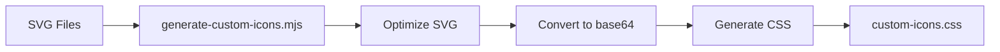

# Custom Icons System

## Overview

FlightPath uses a **codicon-like system** for custom icons not available in VS Code's codicon library.

### Key Features

✅ **No manual copy-paste** - Just add SVG files  
✅ **Automatic CSS generation** - Build script does the work  
✅ **Theme color inheritance** - Uses `currentColor` like codicons  
✅ **Reusable everywhere** - Same icon, multiple locations  
✅ **Clean API** - `<i class="custom-icon icon-name"></i>`

## Quick Start

### 1. Add an SVG Icon

Drop any SVG file into `src/ui/icons/`:

```bash
src/ui/icons/
├── append.svg          # ← Your icon here
├── append-next.svg
└── my-new-icon.svg     # ← Add more anytime
```

### 2. Build

```bash
npm run compile        # Full build (includes icon generation)
# OR
npm run generate-icons # Just regenerate icons
```

### 3. Use in HTML

```html
<!-- Just like codicons! -->
<button>
  <i class="custom-icon icon-append"></i>
  Append
</button>

<!-- Same icon, different place -->
<div>
  <i class="custom-icon icon-append"></i>
  Add to queue
</div>

<!-- With size variant -->
<i class="custom-icon icon-append icon-small"></i>
```

## How It Works

### Build Process



1. **Read SVGs** from `icons/` folder
2. **Optimize** (remove colors, minify)
3. **Convert** to base64 data URIs
4. **Generate** CSS classes with mask-image
5. **Output** `custom-icons.css`

### CSS Mask Technique

Generated CSS uses `mask-image` to inherit colors:

```css
.custom-icon {
  background-color: currentColor; /* Inherits parent text color */
  mask-image: url("data:image/svg+xml;base64,..."); /* SVG shape */
}

.custom-icon.icon-append {
  -webkit-mask-image: url("data:...");
  mask-image: url("data:...");
}
```

**Result:** Icons automatically match VS Code theme colors (light/dark/high contrast)!

## API Reference

### Basic Usage

```html
<i class="custom-icon icon-{filename}"></i>
```

Where `{filename}` is the SVG filename without extension:

- `append.svg` → `.icon-append`
- `my-icon.svg` → `.icon-my-icon`

### Size Variants

```html
<!-- Small 14×14px (default for btn-small) -->
<i class="custom-icon icon-append icon-small"></i>

<!-- Standard 16×16px (default) -->
<i class="custom-icon icon-append"></i>

<!-- Large 20×20px -->
<i class="custom-icon icon-append icon-large"></i>
```

### In Buttons

```html
<!-- Secondary button with icon -->
<button class="btn-secondary">
  <i class="custom-icon icon-append"></i>
  Append
</button>

<!-- Primary button -->
<button class="btn-primary">
  <i class="custom-icon icon-run"></i>
  Run
</button>

<!-- Small button (icon auto-sizes to 14px) -->
<button class="btn-small">
  <i class="custom-icon icon-export"></i>
  Export
</button>
```

## SVG Best Practices

### Ideal SVG Format

```xml
<svg viewBox="0 0 24 24" xmlns="http://www.w3.org/2000/svg">
  <path d="M12 4v16m-8-8h16" stroke="#000000" stroke-width="2"/>
</svg>
```

**Tips:**

- ✅ Use 24×24 viewBox (standard size)
- ✅ Filled paths work best (strokes converted)
- ✅ Monochrome designs (color removed automatically)
- ✅ Simple shapes (better at small sizes)
- ⚠️ Don't worry about colors - script removes them

### The Script Optimizes Automatically

```javascript
// Before (from Streamline)
<path fill="#FF0000" stroke="#000000" .../>

// After (script processes)
<path .../>  // Colors removed, ready for mask
```

## Examples

### Current Icons

```html
<!-- Append to queue -->
<i class="custom-icon icon-append"></i>

<!-- Append next -->
<i class="custom-icon icon-append-next"></i>
```

### Adding New Icons

```bash
# 1. Download SVG from Streamline (or create your own)
# 2. Save to src/ui/webview/icons/my-icon.svg
# 3. Run build
npm run generate-icons

# 4. Use in HTML
<i class="custom-icon icon-my-icon"></i>
```

## Comparison to Other Approaches

### vs. Codicons

| Feature      | Codicons                           | Custom Icons                        |
| ------------ | ---------------------------------- | ----------------------------------- |
| Size         | 2000+ icons (large)                | Only what you need                  |
| Availability | VS Code built-in                   | Custom Streamline icons             |
| Usage        | `<i class="codicon codicon-name">` | `<i class="custom-icon icon-name">` |
| Theme colors | ✅ Yes                             | ✅ Yes (currentColor)               |

**Use codicons when possible, custom icons for missing ones.**

### vs. Inline SVG

| Feature      | Inline SVG              | Custom Icons                |
| ------------ | ----------------------- | --------------------------- |
| Copy-paste   | Manual every time       | Once (build auto-generates) |
| Reusability  | Copy everywhere         | Single class name           |
| Theme colors | Manual `currentColor`   | Automatic                   |
| HTML clutter | High (lots of `<path>`) | Low (`<i class="...">`)     |

### vs. External SVG Files

| Feature       | External ``  | Custom Icons      |
| ------------- | ----------------- | ----------------- |
| Theme colors  | ❌ Fixed colors   | ✅ Inherits theme |
| HTTP requests | Multiple requests | None (inlined)    |
| Offline       | Needs files       | Works (base64)    |

## Troubleshooting

### Icon Not Appearing

1. **Check filename:** `my-icon.svg` → `.icon-my-icon`
2. **Rebuild:** `npm run generate-icons`
3. **Verify CSS:** Check `custom-icons.css` has your icon
4. **Parent color:** Element needs text color for `currentColor`

### Icon Wrong Color

Icons inherit parent text color. Set parent color:

```html
<div style="color: red;">
  <i class="custom-icon icon-append"></i>
  <!-- Will be red -->
</div>
```

### Icon Wrong Size

Check size class:

```html
<!-- Too small? Add icon-large -->
<i class="custom-icon icon-append icon-large"></i>

<!-- Too big? Add icon-small -->
<i class="custom-icon icon-append icon-small"></i>
```

### Build Not Picking Up Changes

```bash
# Clear and rebuild
rm src/ui/webview/custom-icons.css
npm run generate-icons
```

## Development Workflow

### Adding Icons During Development

```bash
# Terminal 1: Watch mode (auto-rebuilds on changes)
npm run watch

# Terminal 2: Add icons
# 1. Drop SVG in icons/ folder
# 2. Re-run icon generation
npm run generate-icons

# 3. Reload VS Code window (Ctrl+R in Extension Development Host)
```

### Production Build

Icons are automatically generated as part of production build:

```bash
npm run build:prod  # Includes generate-icons
```

## Files Involved

```
scripts/
├── generate-custom-icons.mjs    # Build script

src/ui/
├── icons/                       # Source SVGs (NOT in webview, NOT copied)
│   ├── append.svg               # Only used during build
│   └── append-next.svg          # Embedded as base64 in CSS
└── webview/
    ├── custom-icons.css         # Generated CSS (auto-created, copied to output)
    └── dashboard.html           # Uses icons

out/ui/webview/                  # Build output
└── custom-icons.css             # Only CSS copied (SVGs embedded as base64)
```

**Clean separation:** Source assets (`src/ui/icons/`) stay separate from webview files. Only the generated CSS ships with the extension (~10KB for current icons).

## Future Enhancements

- [ ] SVG optimization with SVGO
- [ ] Multiple color support (fill vs stroke)
- [ ] Icon preview in VS Code
- [ ] Hot reload without full rebuild
- [ ] Size variants via CSS variables

---

**Remember:** Just add SVG → run build → use `<i class="custom-icon icon-name"></i>`! 🎨
